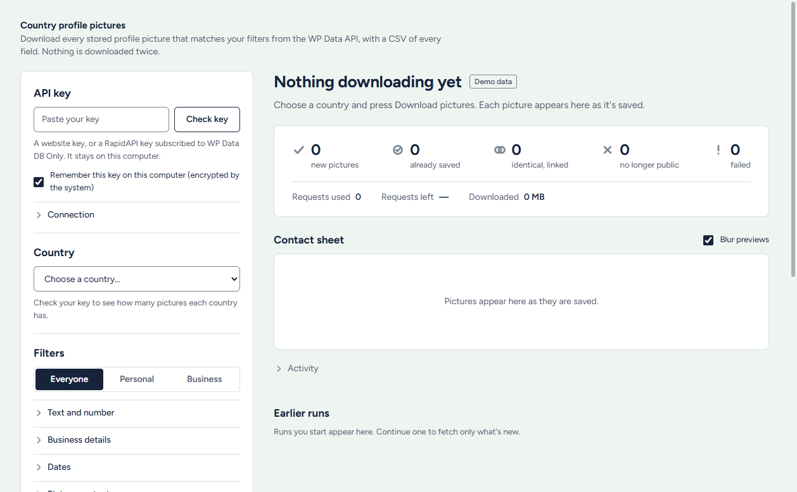
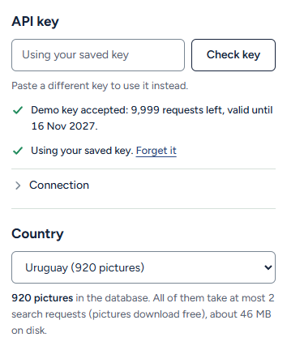
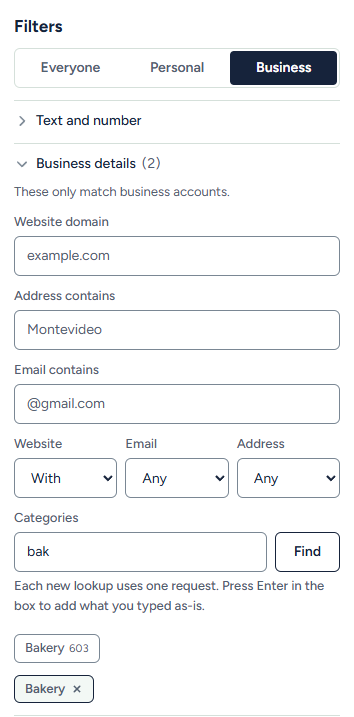
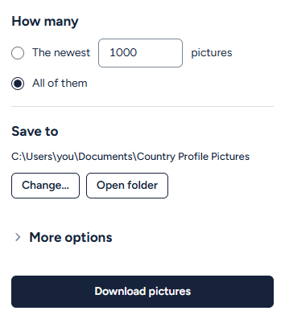
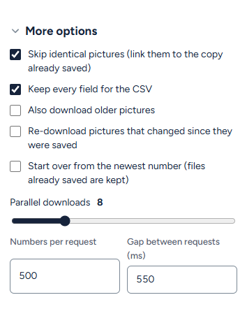
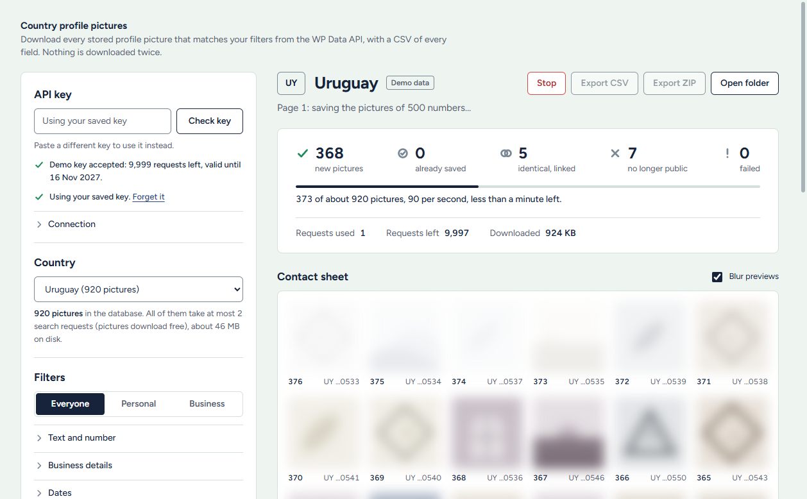
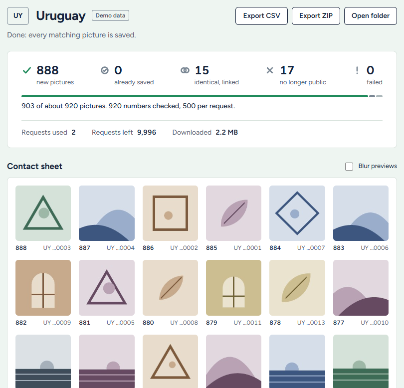
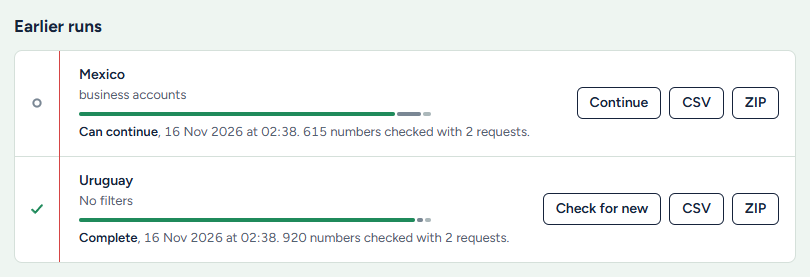

# User guide

How to install **Country Profile Pictures** on Windows, macOS or Linux, download
every profile picture that matches your filters for one country (or all of
them), and export a CSV of every field. No programming needed. In the app,
**Help → User Guide** opens this page.

Installing: [Windows](#on-windows), [macOS](#on-macos), [Linux](#on-linux).
After that, the app works the same everywhere.

> Every screenshot here comes from the app's built-in **demo mode**: the numbers
> are invented and the pictures are drawn by the app, so no real person appears
> in this guide. They were taken on Windows; the app looks the same on macOS and
> Linux. You can try the demo yourself, without a key
> ([Try it without a key](#13-try-it-without-a-key)).

**Contents**

1. [What you need](#1-what-you-need)
2. [Download](#2-download)
3. [Install](#3-install): [Windows](#on-windows), [macOS](#on-macos), [Linux](#on-linux)
4. [Add your API key](#4-add-your-api-key)
5. [Choose a country](#5-choose-a-country)
6. [Filters (optional)](#6-filters-optional)
7. [How many, and where to save](#7-how-many-and-where-to-save)
8. [More options](#8-more-options)
9. [Download the pictures](#9-download-the-pictures)
10. [Stop, continue and update](#10-stop-continue-and-update)
11. [Export a CSV or ZIP](#11-export-a-csv-or-zip)
12. [Where the files are](#12-where-the-files-are)
13. [Try it without a key](#13-try-it-without-a-key)
14. [Troubleshooting](#14-troubleshooting)
15. [Update or uninstall](#15-update-or-uninstall)
16. [Use it responsibly](#16-use-it-responsibly)

---

## 1. What you need

- **A computer** with one of:

  | System | Versions |
  | --- | --- |
  | Windows | 10 or 11, 64-bit |
  | macOS | 12 Monterey or later, on Apple silicon (M1 and later) or Intel |
  | Linux | a 64-bit (x86-64) desktop: Ubuntu 22.04 or later, Debian 12, Linux Mint 21 or later, Fedora and others |

  ARM Linux (a Raspberry Pi, for example) is not supported yet.

- **An API key** for the WP Data API. Either kind works:

  | Key | Where to get it | Looks like |
  | --- | --- | --- |
  | Direct key | [whatsapp.checkleaked.cc/api](https://whatsapp.checkleaked.cc/api) | `wapi_…` |
  | RapidAPI key | [WP Data DB Only on RapidAPI](https://rapidapi.com/airaudoeduardo/api/wp-data-db-only) | a long key with `msh` and `jsn` in it |

  A direct key also shows its remaining requests and expiry date inside the app.

- **Disk space.** A picture is about 50 KB on average, so 10,000 pictures take
  about 500 MB. The app tells you the expected size before you start, and it
  stops on its own if less than 500 MB of disk is left.

## 2. Download

Go to the [latest release](https://github.com/eduair94/country-profile-pics/releases/latest)
and pick the file for your computer:

| System | File | Choose it if |
| --- | --- | --- |
| Windows | [country-profile-pics-windows-setup.exe](https://github.com/eduair94/country-profile-pics/releases/latest/download/country-profile-pics-windows-setup.exe) | You want a normal installed app with a Start menu entry and an uninstaller. **Recommended.** |
| Windows | [country-profile-pics-windows-portable.exe](https://github.com/eduair94/country-profile-pics/releases/latest/download/country-profile-pics-windows-portable.exe) | You don't want to install anything. It starts a little slower, because it unpacks itself each time. |
| macOS | [country-profile-pics-mac-arm64.dmg](https://github.com/eduair94/country-profile-pics/releases/latest/download/country-profile-pics-mac-arm64.dmg) | Your Mac has Apple silicon (M1, M2, M3, M4…). |
| macOS | [country-profile-pics-mac-x64.dmg](https://github.com/eduair94/country-profile-pics/releases/latest/download/country-profile-pics-mac-x64.dmg) | Your Mac has an Intel processor. |
| Linux | [country-profile-pics-linux-x64.deb](https://github.com/eduair94/country-profile-pics/releases/latest/download/country-profile-pics-linux-x64.deb) | Ubuntu, Debian, Linux Mint, Pop!_OS and other Debian-based systems. **Recommended there.** |
| Linux | [country-profile-pics-linux-x64.AppImage](https://github.com/eduair94/country-profile-pics/releases/latest/download/country-profile-pics-linux-x64.AppImage) | Any other distribution (Fedora, Arch, openSUSE…), or if you'd rather not install anything. |

**Which Mac do I have?** Apple menu → **About This Mac**. It says *Chip: Apple M…*
for Apple silicon, or *Processor: … Intel …* for Intel.

**Your browser may warn you** that the file "isn't commonly downloaded". That's
because the app is new and not code-signed. In Edge, open the download list,
click **…** next to the file → **Keep** (and, if it asks again, **Show more** →
**Keep anyway**).

### Check the file (optional)

The release also has `SHA256SUMS.txt`, with a fingerprint for every file.
Download it next to your file to make sure the download is complete and
unmodified:

- **Windows**: open **PowerShell** in your Downloads folder and run
  `Get-FileHash .\country-profile-pics-windows-setup.exe -Algorithm SHA256`.
  The `Hash` it prints must match that file's line in `SHA256SUMS.txt`
  (capital or small letters don't matter).
- **macOS**: open **Terminal** and run
  `shasum -a 256 ~/Downloads/country-profile-pics-mac-arm64.dmg`
  (or `-x64`), then compare with `SHA256SUMS.txt`.
- **Linux**: in a terminal, run
  `cd ~/Downloads && sha256sum --check --ignore-missing SHA256SUMS.txt`.
  It prints `OK` next to each file you downloaded.

## 3. Install

### On Windows

1. Double-click `country-profile-pics-windows-setup.exe`.
2. If Windows shows **"Windows protected your PC"**, click **More info**, then
   **Run anyway**. Windows shows this for every app that isn't code-signed yet.
3. Choose **Only for me** (no administrator rights needed) or
   **Anyone who uses this computer**.
4. Keep the suggested folder or pick another one, then click **Install**.
   For "only me" it is `%LOCALAPPDATA%\Programs\Country Profile Pictures`.
5. Click **Finish**. The app opens.

From now on, open it from the Start menu or the desktop shortcut,
**Country Profile Pictures**.

With the portable file, skip all of this: double-click it (and pass the same
SmartScreen warning the first time).

### On macOS

1. Double-click the `.dmg` you downloaded. In the window that opens, drag
   **Country Profile Pictures** onto the **Applications** folder.
2. Eject the disk image (the ⏏ button next to it in Finder's sidebar).
3. Open **Applications** and double-click **Country Profile Pictures**.

The first time, macOS stops it, because the app isn't notarized by Apple yet:

- **macOS 15 Sequoia and later**: macOS says *"Country Profile Pictures" Not
  Opened*. Click **Done**. Open **System Settings → Privacy & Security**, scroll
  down to *"Country Profile Pictures" was blocked to protect your Mac*, click
  **Open Anyway**, enter your password, and click **Open Anyway** once more.
- **macOS 14 Sonoma and earlier**: Control-click (or right-click) the app in
  Applications, choose **Open**, then click **Open** in the message.

You only do this once. If macOS ever says the app **"is damaged and can't be
opened"**, run this once in **Terminal**, then open it again:

```sh
xattr -dr com.apple.quarantine "/Applications/Country Profile Pictures.app"
```

Two more questions may come up, and both are safe to allow:

- *"Country Profile Pictures" would like to access files in your Documents
  folder*: that's where pictures are saved. Click **Allow**.
- *Country Profile Pictures wants to use your confidential information stored in
  "Country Profile Pictures Safe Storage" in your keychain*: that's your saved
  API key. Click **Always Allow**. It can ask again after you update the app.

On a Mac, the menus (**File**, **Help**…) are in the menu bar at the top of the
screen.

### On Linux

**With the `.deb`** (Ubuntu, Debian, Mint…), open a terminal and run:

```sh
cd ~/Downloads
sudo apt install ./country-profile-pics-linux-x64.deb
```

Then open **Country Profile Pictures** from your applications menu. The package
also installs what Chromium's security sandbox needs on Ubuntu 24.04 and later.

**With the AppImage**, run:

```sh
cd ~/Downloads
chmod +x country-profile-pics-linux-x64.AppImage
./country-profile-pics-linux-x64.AppImage
```

Or right-click the file → **Properties** → allow it to run as a program, then
double-click it. Keep it somewhere permanent, such as `~/Applications`. AppImages
need FUSE 2: if nothing happens, see [Troubleshooting](#14-troubleshooting).

On Ubuntu 23.10 and later, the system doesn't let an AppImage use Chromium's
security sandbox, so the AppImage turns it off by itself and starts anyway. The
`.deb` installs a security profile that keeps the sandbox on, which is why it's
the better choice on Ubuntu.

The API key can be remembered only if your desktop has a keyring (GNOME Keyring
or KWallet; Ubuntu, Mint, Fedora and KDE desktops have one). Without one, the
app doesn't offer to remember it and you paste it each time you open the app.

---

When the app opens, it looks like this:



The left column is the form you fill in, from top to bottom. The right column
shows the download as it happens, and lists your earlier runs below it.

## 4. Add your API key

1. Paste your key into the **API key** box.
2. Click **Check key** (or press <kbd>Enter</kbd>).

If the key works, you'll see its plan, the requests it has left and until when
it is valid, like *"Demo key accepted: 9,999 requests left…"* in the picture
below (your own key shows its plan instead of *Demo*). A RapidAPI key just says
*"RapidAPI key accepted."* The country list then shows how many pictures each
country has.

Leave **Remember this key on this computer (encrypted by the system)** ticked
and you won't have to paste it again. Your system encrypts it for your user
account: Windows does it itself, macOS keeps it in your Keychain, and Linux in
your keyring. The box then says **Using your saved key**. To remove it, click
**Forget it**. To use a different key, paste it and click **Check key** again.



The app works out from the key whether to send it to the website's API or to
RapidAPI. If you ever need to force one, open **Connection** under the key box.

Checking the key itself is free. Loading the picture counts costs one request,
and the app reuses them for 30 minutes.

## 5. Choose a country

Pick a country from the **Country** list. The countries with the most pictures
come first, with their counts. **All countries** downloads from every country
at once.

Under the list, the app estimates the run before you start: how many pictures
the country has, how many **search requests** that takes at most, and how much
disk space. One search request returns up to 500 numbers. The pictures
themselves download for free, so a whole country costs about **one request per
500 pictures**.

## 6. Filters (optional)

With no filters you get every number in the country that has a stored picture.
The app only ever asks for numbers that have a picture, so no request is spent
on a number without one.

To narrow it down, use **Filters**:



| Filter | What it does |
| --- | --- |
| **Everyone / Personal / Business** | Only personal accounts, only business accounts, or both. |
| **Text and number** | *Words in name, about or business details*, for example `pizza` (needs a country, not All countries). *Number starts with*: at least 6 digits, country code included, for example `598991`. |
| **Business details** | Website domain, address and email that contain some text, and whether the business has a website, email or address at all. These only match business accounts. |
| **Categories** | Type a word such as `restaurant`, click **Find**, then click the categories to add. Each new word you look up costs one request. Press <kbd>Enter</kbd> in the box to add exactly what you typed. With two or more, choose whether a business must match **any** of them or **all**. |
| **Dates** | Only numbers *last seen* (or *first seen*) between two dates. |
| **Picture content** | From the automatic picture analysis: shows a woman or a man, an age range, how many people, glasses, beard, and picture tags such as `dog, beach`. Only pictures that were analysed can match. |

A small number next to each group shows how many of its filters are set.

Every combination of filters is its own **run**, with its own progress. Pictures
are still shared between runs: a picture you already have is never downloaded
again, whatever filters found it.

There is deliberately no ethnicity filter, and the age range can't end below
18.

## 7. How many, and where to save



**How many**: **The newest *N* pictures** (1,000 unless you change it) or
**All of them**. Numbers come newest first, so a limit gives you the most
recently added ones.

**Save to**: pictures go to the **Country Profile Pictures** folder inside your
**Documents** folder unless you click **Change…** and pick another one.
**Open folder** opens it in File Explorer, Finder or your file manager. The
**File** menu has the same two commands. A download that is already running
keeps saving to the folder it started in.

## 8. More options

Click **More options** to fine-tune a run. The defaults are right for almost
everyone.



| Option | Default | What it does |
| --- | --- | --- |
| **Skip identical pictures** | on | When several numbers have exactly the same picture (a shop chain's logo, say), it is saved once and the other numbers are linked to it. |
| **Keep every field for the CSV** | on | Saves each number's full record, so the CSV has every field. Turn it off to keep only the pictures. |
| **Also download older pictures** | off | Also saves the earlier pictures the API kept for a number, as `<number>_2.jpg` and so on. |
| **Re-download pictures that changed** | off | When a number has a new picture since you saved it, downloads the new one. |
| **Start over from the newest number** | off | Walks the list from the top again instead of continuing. Files you already have are kept and skipped. |
| **Parallel downloads** | 8 | How many pictures download at the same time (1 to 32). |
| **Numbers per request** | 500 | The most the API allows. Lower it only if a very selective filter keeps timing out (the app already does this by itself). |
| **Gap between requests** | 550 ms | The API refuses requests less than half a second apart, so keep it at 500 or more. |

## 9. Download the pictures

Click **Download pictures**. The right column follows the run:



The run's country is the headline, with **Stop** and the two export buttons
beside it. The five totals under it each start with their mark, which takes its
colour with the first result of its kind:

| Mark | Total | Meaning |
| --- | --- | --- |
| A green tick | **New pictures** | Downloaded in this run. |
| A ticked ring | **Already saved** | Already on disk from an earlier run, so skipped. |
| Two linked rings | **Identical, linked** | Exactly the same picture as one already saved, so linked to it instead of saved again. |
| A cross | **No longer public** | The picture was removed, or its owner hid their number. Nothing to download. These don't count towards your limit. |
| A red exclamation mark | **Failed** | Could not be downloaded after several tries. They are retried first on your next run. |

The line under them shows progress, speed and the time left. When the run ends
it turns into a bar with one part per result, in the same order as the totals
and as wide as its share: green for new pictures, red for failed. Below it is
what the run cost:

| | Meaning |
| --- | --- |
| **Requests used** | Search requests this run spent from your key. |
| **Requests left** | What your key has left, as the API reported it after the last request. |
| **Downloaded** | Disk space used by this run's new pictures. |

The **contact sheet** shows the 48 most recent pictures. Previews are blurred
until you untick **Blur previews**. This only changes the preview. The files
on disk are never blurred.



When the line under the country says **Done: every matching picture is
saved**, the run is complete. **Activity**, under the contact sheet, lists
anything worth knowing, such as retries and pictures that failed, each with its
time.

## 10. Stop, continue and update

You can stop at any time and lose nothing:

- **Stop** ends the run right away. Every picture already saved is kept.
- **Quitting the app** stops running downloads cleanly first. On a Mac, closing
  the window doesn't quit the app: downloads keep going in the background until
  you quit with <kbd>⌘</kbd> <kbd>Q</kbd>, and clicking the Dock icon brings the
  window back.
- Even a crash or power cut loses nothing: every saved picture is already
  recorded, and the next run skips it.

**Earlier runs**, at the bottom of the right column, lists every run you have
made in this folder:



A green tick in front of a run means it is complete; an open ring means it can
continue. The bar under its name shows its results the same way as the bar of a
finished run, followed by when it last ran and what it has cost.

- **Continue** (a run that was stopped or hit its limit) puts the run's filters
  back in the form and carries on exactly where it stopped. At most one search
  request is repeated.
- **Check for new** (a complete run) fetches only the numbers added since.
  When there is nothing new, that costs a single request.
- **CSV** and **ZIP** export that run (next section).

You can also fill in the same filters by hand and click **Download pictures**.
The app recognises the run and continues it.

## 11. Export a CSV or ZIP

When a run has finished (or been stopped), click **Export CSV** or
**Export ZIP** at the top of the run, or the **CSV** / **ZIP** button next to a
run under **Earlier runs**. The app asks where to save the file.

- **CSV**: one row per number. It starts with `country`, `number`,
  `picture_file` (where the picture is on disk), `picture_shared` (`yes` when the
  number is linked to an identical picture), `picture_bytes`, `picture_md5` and
  `history_files`, followed by every field of the record: `about`, `isBusiness`,
  `date`, `businessProfile.email`, `businessProfile.address`, the picture
  analysis and so on. It opens directly in Excel, Numbers or LibreOffice,
  accents included.
- **ZIP**: the same CSV plus the run's pictures, ready to send or archive.

Exports are made from what's on disk, so they never cost a request. If a CSV
with the same name is open in Excel, the new one gets a dated name instead of
failing.

## 12. Where the files are

Everything goes into the folder shown under **Save to**:

```
Country Profile Pictures/
  pictures/UY/598XXXXXXXX.jpg       a number's current picture
  pictures/UY/598XXXXXXXX_2.jpg     an older picture ("Also download older pictures")
  data/UY.jsonl                     every record the API returned
  data/UY.files.csv                 list of every picture: size, fingerprint, links
  runs/                             each run's position, filters and totals
  exports/                          CSV and ZIP files the app made
```

Pictures are named by phone number, so you can find one directly. A number
linked to an identical picture has no file of its own: its row in the CSV
points to the shared file.

Don't edit the `data` and `runs` folders by hand. That is how the app knows
what you already have.

Where the app keeps things on each system:

| | Pictures (unless you chose another folder) | Settings and your encrypted key |
| --- | --- | --- |
| Windows | `Documents\Country Profile Pictures` | `%APPDATA%\Country Profile Pictures` |
| macOS | `~/Documents/Country Profile Pictures` | `~/Library/Application Support/Country Profile Pictures` |
| Linux | `~/Documents/Country Profile Pictures` | `~/.config/Country Profile Pictures` |

To open one of these folders: on Windows, paste the path into the File Explorer
address bar; on a Mac, in Finder choose **Go → Go to Folder…** and paste it.

## 13. Try it without a key

Open **Help → Try the Demo (No Key Needed)** (version 1.0.1 or later). The
window switches to demo mode, with *(demo)* in its title and a **Demo data**
label next to the run. If a download is running, the app asks first, then stops
it with its progress saved.

- Type anything as the key and click **Check key**.
- Everything works as with a real key, from filters to CSV, but the numbers are
  invented (they all have a `0` right after the country code, which no real
  number has) and the pictures are drawn by the app. Nothing is sent over the
  internet.
- Demo files go to a temporary folder, separate from your real downloads, and
  demo mode has its own settings, so it never touches your real key or folder.

**Help → Leave Demo Mode** switches back to your real key and folder.

## 14. Troubleshooting

**Any system**

| What you see | What to do |
| --- | --- |
| "The API key was rejected (401)" or "(403)" | Check the key for missing characters. If it is a RapidAPI key, make sure it is subscribed to **WP Data DB Only**. Under **Connection**, try the other option. |
| "The key has no requests left (429)" | Your key's quota is used up. Progress is saved; continue the run when the quota renews or with another key. |
| "Rate limited (429)" in Activity | Requests came too close together. The app waits and retries by itself. If it keeps happening, raise **Gap between requests**. |
| A filter is very slow, or "The search timed out on the server" | Some combinations (for example business accounts with a website in a big country) are slow for the API. The app asks for smaller pages and retries. If it still stops, continue later or narrow the filters, for example with a date range. |
| Some pictures **Failed** | Usually a temporary network or server error. Run again: failed pictures are retried first, without using a search request. |
| Many pictures **No longer public** | Normal. People remove pictures or hide their number. |
| "A download with these filters is already running." | That run is already going, in this window or another copy of the app. Wait for it, or click **Stop**. |
| It stopped saying the disk is almost full | Free some space, or click **Change…** to save to a bigger drive (the runs will then start fresh there). |
| A country shows no picture count | Only the countries with the most numbers have counts. Downloading still works. |

**Windows**

| What you see | What to do |
| --- | --- |
| "Windows protected your PC" | Click **More info → Run anyway**. The app is not code-signed yet. |
| The app doesn't open, or opens slowly | The portable file unpacks itself on every start, which can take a few seconds. Some antivirus programs scan it the first time; allow it, or use the installer. |

**macOS**

| What you see | What to do |
| --- | --- |
| *"Country Profile Pictures" Not Opened*, or *can't be opened because Apple cannot check it* | Allow it once, as in [Install on macOS](#on-macos). |
| *"Country Profile Pictures" is damaged and can't be opened* | Run `xattr -dr com.apple.quarantine "/Applications/Country Profile Pictures.app"` in Terminal, then open it again. Nothing is wrong with the app: macOS says this about downloaded apps that aren't notarized. |
| It asks for your keychain password | That's your saved API key. Enter your Mac's login password and click **Always Allow**. |
| Downloads go on after closing the window | That's how Mac apps work. Quit with <kbd>⌘</kbd> <kbd>Q</kbd> to stop them (progress is saved). |

**Linux**

| What you see | What to do |
| --- | --- |
| The AppImage doesn't start, or says *AppImages require FUSE to run* (`dlopen(): error loading libfuse.so.2`) | Install FUSE 2: `sudo apt install libfuse2t64` on Ubuntu 24.04 and later, `sudo apt install libfuse2` on older Ubuntu and Debian, `sudo dnf install fuse-libs` on Fedora. Or start it with `./country-profile-pics-linux-x64.AppImage --appimage-extract-and-run`. |
| No "Remember this key" box | Your desktop has no keyring. Install one (`sudo apt install gnome-keyring` on Ubuntu and Debian), log out and in, or paste the key each time. |

Still stuck? [Open an issue](https://github.com/eduair94/country-profile-pics/issues)
and copy what **Activity** shows. The app removes your key from it, but never
paste the key itself.

## 15. Update or uninstall

The app doesn't update itself. To update, download the newest file from the
[latest release](https://github.com/eduair94/country-profile-pics/releases/latest)
and install it the same way as the first time. Your key, folder and downloads
stay as they are.

| | Update | Uninstall |
| --- | --- | --- |
| Windows installer | Run the new `country-profile-pics-windows-setup.exe`. It replaces the old version. | **Settings → Apps → Installed apps** (Windows 10: **Apps & features**) → **Country Profile Pictures** → **Uninstall**. |
| Windows portable | Use the new file instead of the old one. | Delete the file. |
| macOS | Drag the new app onto **Applications** and choose **Replace**. | Drag **Country Profile Pictures** from **Applications** to the Trash. |
| Linux `.deb` | `sudo apt install ./country-profile-pics-linux-x64.deb` with the new file. | `sudo apt remove country-profile-pics` |
| Linux AppImage | Use the new file instead of the old one. | Delete the file. |

Uninstalling never deletes your pictures. To remove everything, also delete the
two folders listed in [Where the files are](#12-where-the-files-are): your
download folder, and the settings folder (which holds your encrypted key). On a
Mac you can also delete *Country Profile Pictures Safe Storage* in the
**Keychain Access** app.

## 16. Use it responsibly

These are pictures of real people. Collect and keep them only where the law
allows, for a purpose you can justify, and keep them secure. In many places
(the EU's GDPR, for example) bulk collection of personal data needs a lawful
basis and has to respect the rights of the people in it.

Anyone can hide their number at
[whatsapp.checkleaked.cc/opt-out](https://whatsapp.checkleaked.cc/opt-out).
Hidden numbers disappear from the API, and their pictures then show up as
*No longer public*.

This project is not affiliated with, endorsed by or sponsored by WhatsApp LLC or
Meta Platforms, Inc.
